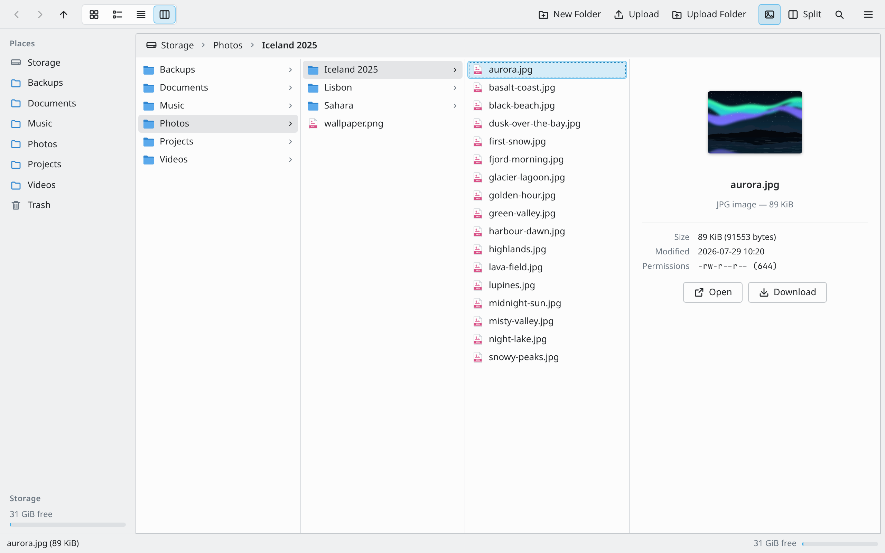
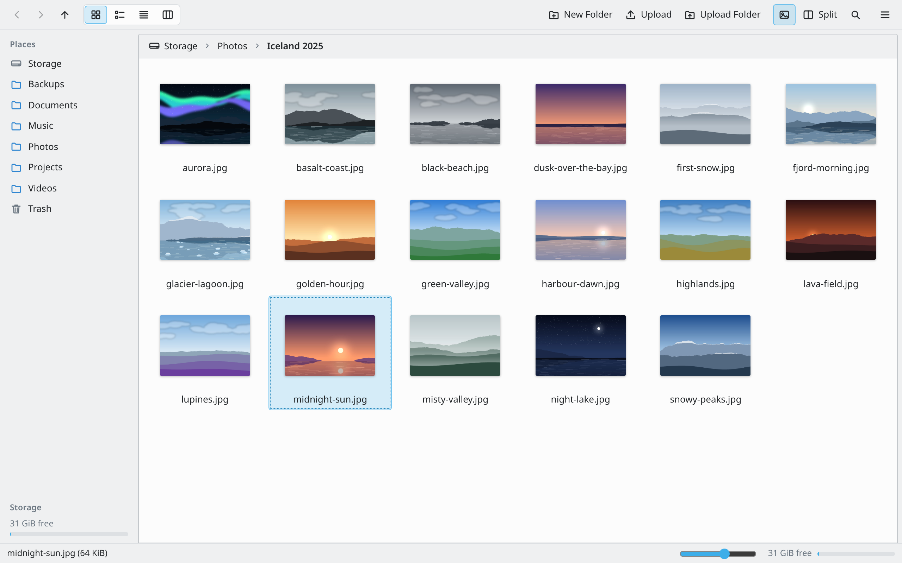
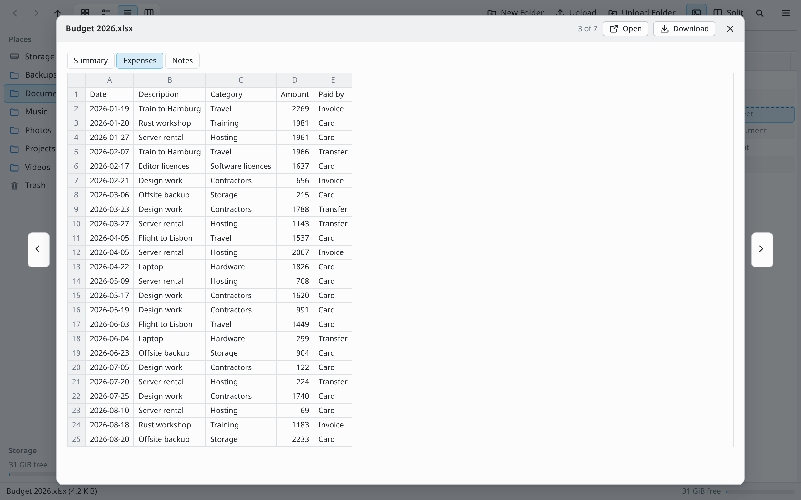
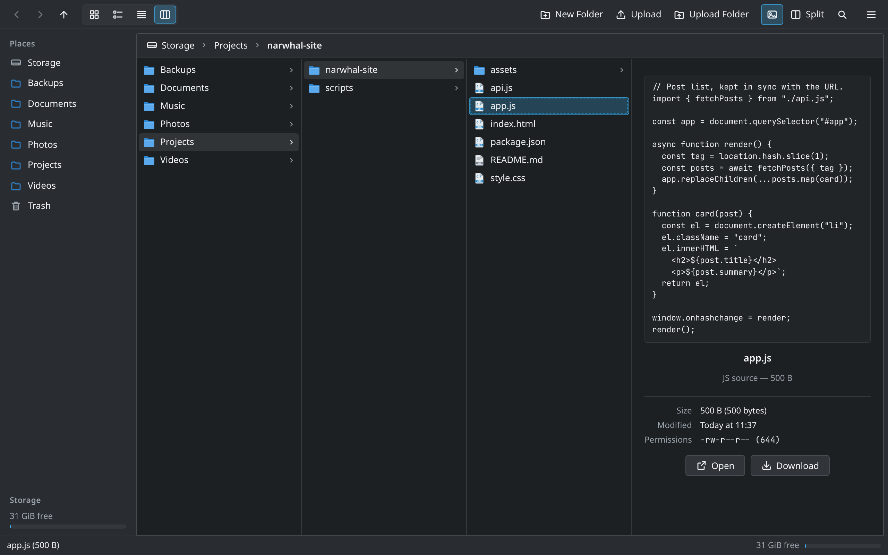

# Narwhal

A web file manager for Kubernetes volumes, styled after desktop file managers
like KDE's Dolphin. The UI is Rust compiled to WebAssembly
([Leptos](https://leptos.dev)); the backend is a small [Axum](https://github.com/tokio-rs/axum)
server that confines every operation to one root directory (your PVC).

One container, one port, ~30 MB image, ~650 KB of gzipped WASM.



## Features

- **Places panel** with the volume and its top-level folders (or a fixed list), plus a free-space meter
- **Breadcrumb location bar** — click a segment to jump, click empty space (or Ctrl+L) to type a path
- **Four view modes** (Ctrl+1–4): Icons (with image thumbnails and a zoom slider), Compact,
  Details (sortable columns), and **Columns**, a macOS Finder–style view:
  - one column per folder from the root down; click a folder and its contents open to the right
  - selecting a file shows a preview panel with its contents — images, video, audio, PDFs,
    and the start of text and source files — plus size, dates and Open/Download
  - Left/Right arrows move between columns, Up/Down within one
  - drag a column's edge to resize it (Alt+drag: all columns, double-click: fit the names)
  - drag items onto any folder in any column; right-click works in every column
- **Quick Look** (Space): a large preview of the selected item — images, video, audio, PDFs,
  text, office documents — that follows the arrow keys; Space or Esc closes it
- **Office previews** in the column view and Quick Look: the text of Word documents (doc,
  docx, odt) with headings, lists and tables; the cells of spreadsheets (xls, xlsx, ods) with
  a tab per sheet; the text of each slide of presentations (ppt, pptx, odp). Documents are read
  in the browser, never on the server, and only their beginning is shown (500 rows × 40
  columns of a sheet)
- **Split view** (F3) with independent history per pane; drag between panes to move, hold Ctrl to copy
- **Selection** like a desktop: click, Ctrl+click, Shift+click, arrow keys, Ctrl+A
- **Trash**: Delete moves items to the Trash (with Undo); restore them to where they were, delete
  them for good, or empty it. Shift+Delete skips the Trash. Old items are removed after 30 days
- **File operations**: new folder/file, inline rename (F2), cut/copy/paste, delete,
  upload (button or drag files and folders from your desktop), download, open in a new tab
- **Reliable uploads**: every file is checked against a SHA-256 checksum on the server and only
  appears once it arrived intact; interrupted, stalled or damaged files are retried automatically
  (also after the network drops for a while). Several files go up in parallel (adjustable), and
  files added during an upload join its queue.
  Click the upload bar for each file's state, the speed and time left; any file (or all) can be cancelled there
- **Filter bar** (Ctrl+I) and **recursive name search** (Ctrl+F)
- **Properties** dialog with recursive folder size and permissions
- Hidden files toggle, natural sorting (`file2` before `file10`), light/dark theme from the OS,
  view preferences remembered per browser, current folder kept in the URL (`#/Photos/2025`)
- Mouse back/forward buttons work; F1 lists every shortcut

## Screenshots

Icons with image thumbnails (the zoom slider is in the status bar):



Quick Look on a spreadsheet, with a tab per sheet:



The dark theme, which follows the OS, with a source file in the column view's preview:



## Layout

```
shared/     serde types used by both sides (Entry, Listing, requests…)
server/     Axum API + static file serving         → binary `narwhal`
frontend/   Leptos CSR app built with Trunk         → frontend/dist
              (src/columns.rs is the column view)
office/     reads office documents for the previews (used by the frontend)
deploy/     Kustomize manifests (namespace, PVC, Deployment, Service, Ingress)
Dockerfile  multi-stage build → scratch runtime image
```

## Running locally

Requirements: Rust (stable), the `wasm32-unknown-unknown` target and [Trunk](https://trunkrs.dev).

```sh
rustup target add wasm32-unknown-unknown
cargo install trunk --locked           # or download a release binary

# 1. build the UI once
cd frontend && trunk build --release && cd ..

# 2. serve a folder of your choice
NARWHAL_ROOT=$HOME/some-folder NARWHAL_STATIC_DIR=frontend/dist cargo run -p narwhal-server
# → http://localhost:8080
```

For UI work with live reload, run the server as above and in another terminal
`cd frontend && trunk serve` (port 8081; `/api` is proxied to 8080).

Tests: `cargo test -p narwhal-server -p narwhal-shared -p narwhal-office -p narwhal-frontend`
(path traversal, symlink escape and races, copy/move/rename/delete, Trash, search, naming,
document formats, text encodings). To check the document readers on your own files:
`OFFICE_SAMPLES=some/folder cargo test -p narwhal-office samples -- --ignored --nocapture`.

Formatting and lints: `cargo fmt --all && leptosfmt frontend/src` (the second
formats the markup in `view!` macros; `cargo install leptosfmt`), then
`cargo clippy -p narwhal-server -p narwhal-shared -p narwhal-office --all-targets` and
`cargo clippy -p narwhal-frontend --target wasm32-unknown-unknown`.

Fuzzing the document readers (needs nightly Rust and `cargo install cargo-fuzz`):
`cp Cargo.lock fuzz/ && cargo +nightly fuzz run zip_parts` (targets: `parse`,
`zip_parts`, `cfb_streams`).

### CI

Every push and pull request runs one pipeline, `ci`:

- **push to `dev`**: the tests, then the image build (`:latest`)
- **pull request**: the tests, `lint`, `security` and a short `fuzz` run side by side,
  then the image build and scan (nothing pushed); a comment on the PR sums up the results
- **push to `main`**: the same checks, then the release build and release

Changes to only the docs (Markdown files and `docs/`) skip the tests, build and
release once the rest of the code has passed them; a pull request still
spell-checks the docs.

| Workflow | What it does |
| --- | --- |
| `ci` | The pipeline. Every image is scanned with Trivy: builds fail on fixable HIGH/CRITICAL vulnerabilities, and the run summary has a table. Its `checks` job is the one to require in branch rules |
| `lint` | rustfmt + leptosfmt, clippy, typos, actionlint, hadolint, kubeconform |
| `security` | zizmor (workflow security); also weekly. CodeQL runs through GitHub's default setup |
| `fuzz` | Fuzzes the document readers: a minute per target in `ci`, 10 minutes weekly |
| `image scan` | Scans the latest released image daily, so newly published vulnerabilities show up; fails (GitHub emails you) on fixable HIGH/CRITICAL ones |

Reports from Trivy, zizmor and hadolint go to Security → Code scanning. Actions
are pinned to commits and the Dockerfile's base images to digests; Dependabot
keeps both up to date.

## Container image

```sh
docker build -t ghcr.io/amreshh/narwhal:latest .

# Docker: run as your own user so the mounted folder is writable.
# 127.0.0.1 keeps it off your network: there is no login.
docker run --rm -p 127.0.0.1:8080:8080 --user "$(id -u):$(id -g)" \
  -v "$HOME/Downloads:/data" ghcr.io/amreshh/narwhal:latest

# Rootless Podman: map your user to the image's UID 65532 instead
podman run --rm -p 127.0.0.1:8080:8080 --userns=keep-id:uid=65532,gid=65532 \
  -v "$HOME/Downloads:/data" ghcr.io/amreshh/narwhal:latest
```

The server listens on port **8080** inside the container, so the right-hand side
of `-p` must be `8080`. On SELinux hosts (Fedora, RHEL) add
`--security-opt label=disable`, or `:z` on the volume, to let the container read
the folder.

The runtime image is built `FROM scratch`: just the server (a static musl
binary) and the frontend, with no operating system files at all (no shell, C
library, CA certificates or time zone data). Its health check (`narwhal
healthcheck`, which asks `/healthz`) shows in `docker ps`.

The build stage needs network access to crates.io and GitHub (Trunk downloads
`wasm-bindgen` and `wasm-opt` on first use). Multi-arch works with
`docker buildx build --platform linux/amd64,linux/arm64`.

## Deploying to Kubernetes

1. The manifests run a release from GHCR: to upgrade, bump its version in
   `deploy/deployment.yaml`. To run your own build, push it and set its name in
   `deploy/kustomization.yaml`.
2. Set your hostname in `deploy/ingress.yaml` and **enable authentication**
   (see below).
3. `kubectl apply -k deploy`

To browse an existing volume instead of creating a new one, remove `pvc.yaml`
from the kustomization and set `claimName` in `deployment.yaml`.

The pod runs as UID/GID 65532 with a read-only root filesystem, no capabilities
and the `restricted` Pod Security level; `fsGroup` makes the volume writable.
With a ReadWriteOnce volume keep `replicas: 1` (strategy `Recreate`).

### Configuration

| Variable | Default | Meaning |
|---|---|---|
| `NARWHAL_ROOT` | `/data` | Directory to serve. Nothing outside it is reachable. |
| `NARWHAL_ROOT_NAME` | `Storage` | Name shown for the root in the sidebar and breadcrumb. |
| `NARWHAL_READ_ONLY` | `false` | `true` rejects every write (upload, rename, delete, …). |
| `NARWHAL_TRASH` | `true` | `false` makes Delete remove items permanently (after a confirmation). Trashed items live in `.narwhal-trash` in the root, on the same volume. |
| `NARWHAL_TRASH_DAYS` | `30` | Items older than this are removed from the Trash (checked hourly); `0` = keep forever. |
| `NARWHAL_PLACES` | *(empty)* | Fixed sidebar entries: `Docs=/documents,Media=/media`. Empty = top-level folders. |
| `NARWHAL_UPLOAD_PARALLEL` | `3` | Default number of files the app uploads at once (1–16). Users can change it for their browser in the menu or the upload panel. |
| `NARWHAL_MAX_UPLOAD_MB` | `0` | Largest file that can be uploaded; `0` = unlimited. |
| `NARWHAL_STATIC_DIR` | `./static` | Built frontend (`/app/static` in the image). |
| `NARWHAL_ALLOWED_HOSTS` | *(empty)* | Comma-separated host names the server answers to, e.g. `files.example.com,localhost`. Other hosts get 403 (blocks DNS rebinding). Empty = any. `/healthz` is always allowed. |
| `NARWHAL_BIND` | `[::]:8080` | Listen address. The default accepts IPv4 and IPv6 (falls back to IPv4 if IPv6 is disabled); `0.0.0.0:8080` forces IPv4 only. |
| `RUST_LOG` | `info,tower_http=info` | Log filter. |

## Security notes

- **There is no built-in login.** Anyone who can reach the Service can read and
  modify the volume. Put it behind your ingress's authentication — the ingress
  manifest has commented annotations for oauth2-proxy — or set `NARWHAL_READ_ONLY=true`.
- Write requests from other sites are refused (checked with the browser's
  `Sec-Fetch-Site` / `Origin` headers), so a malicious page cannot upload or
  delete with your login. Set `NARWHAL_ALLOWED_HOSTS` to your hostname to also
  refuse DNS-rebinding requests. Pages are sent with `X-Frame-Options: DENY`.
- All paths are resolved against the root; `..` is rejected and symlinks that
  point outside the root are refused. Folders are opened one name at a time and
  every operation works on the opened folder, so swapping a folder for a symlink
  while a request runs can't lead outside the root either.
- The app's pages are sent with a strict `Content-Security-Policy` (only its own
  scripts), `nosniff` and `Referrer-Policy: no-referrer`.
- Invalid settings (e.g. `NARWHAL_READ_ONLY=ture`) stop the server at startup
  instead of silently falling back to a default.
- Files opened "in a new tab" are served with `Content-Security-Policy: sandbox`
  and `nosniff`, so an uploaded HTML or SVG file cannot run scripts against the app.
  PDFs are the exception (browser PDF viewers refuse sandboxed pages and isolate
  PDF scripts themselves); only the app itself may embed them, for the preview.
- Uploads are written to a hidden temp file and renamed into place; name clashes
  get ` (1)`, ` (2)`… suffixes rather than overwriting. Uploads, copies, moves and
  renames never replace an existing file.

## API

All endpoints take and return JSON; paths are virtual (`/` = the root).

| Method | Path | Body / query |
|---|---|---|
| GET | `/api/info` | volume name, read-only flag, disk usage, places |
| GET | `/api/list?path=` | folder listing |
| GET | `/api/search?path=&q=` | recursive name search (max 500 results) |
| GET | `/api/size?path=` | recursive size |
| GET | `/api/download?path=[&inline=true]` | file download (supports Range) |
| PUT | `/api/upload?path=&rel=&size=&sha256=[&retry=true]` | one file as the raw body; `rel` may include folders (created as needed); kept only if size and SHA-256 match |
| POST | `/api/mkdir`, `/api/touch` | `{ "path": parent, "name": … }` |
| POST | `/api/rename` | `{ "path": …, "new_name": … }` |
| POST | `/api/transfer` | `{ "paths": [...], "dest": folder, "op": "copy" \| "move" }` |
| POST | `/api/delete` | `{ "paths": [...] }` — deletes permanently |
| GET | `/api/trash` | items in the Trash (id, original path, deletion time) |
| POST | `/api/trash` | `{ "paths": [...] }` — move to the Trash |
| POST | `/api/trash/restore`, `/api/trash/purge` | `{ "ids": [...] }` — put back / delete for good |
| POST | `/api/trash/empty` | empty the Trash |
| GET | `/healthz` | liveness/readiness |

## Known limitations

- Thumbnails are the original images (lazy-loaded, ≤25 MB each), not server-side resized.
- Downloading a folder as an archive isn't implemented.
